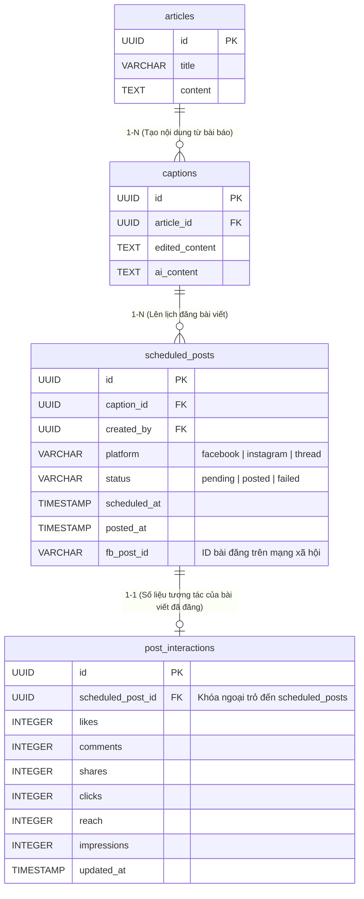
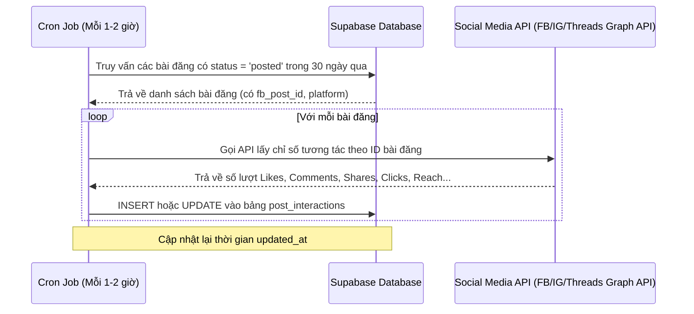

# Hướng dẫn Tích hợp Backend cho Chức năng Báo cáo Thống kê (Reports & Stats)

Tài liệu này cung cấp hướng dẫn chi tiết về cấu trúc cơ sở dữ liệu, các hợp đồng API (API Contracts), chính sách bảo mật RLS và cơ chế đồng bộ dữ liệu tương tác để đội ngũ Backend có thể triển khai hệ thống tương thích 100% với Frontend hiện tại.

---

## 1. Sơ đồ Kiến trúc Dữ liệu

Dưới đây là mô hình liên kết dữ liệu giữa các bảng trong hệ thống để phục vụ chức năng thống kê báo cáo:



---

## 2. Cấu trúc Database (SQL Migration)

Để lưu trữ các chỉ số tương tác thực tế từ các bài viết đã được xuất bản, cần khởi tạo bảng `post_interactions` và thiết lập khóa ngoại liên kết. Chạy đoạn SQL sau trong database:

```sql
-- 1. Tạo bảng lưu trữ số liệu tương tác của bài viết
CREATE TABLE IF NOT EXISTS public.post_interactions (
    id UUID PRIMARY KEY DEFAULT gen_random_uuid(),
    scheduled_post_id UUID UNIQUE NOT NULL,
    likes INTEGER DEFAULT 0 NOT NULL,
    comments INTEGER DEFAULT 0 NOT NULL,
    shares INTEGER DEFAULT 0 NOT NULL,
    clicks INTEGER DEFAULT 0 NOT NULL,
    reach INTEGER DEFAULT 0 NOT NULL,
    impressions INTEGER DEFAULT 0 NOT NULL,
    created_at TIMESTAMP WITH TIME ZONE DEFAULT timezone('utc'::text, now()) NOT NULL,
    updated_at TIMESTAMP WITH TIME ZONE DEFAULT timezone('utc'::text, now()) NOT NULL,
    
    -- Khóa ngoại liên kết 1-1 với bảng scheduled_posts
    CONSTRAINT fk_post_interactions_scheduled_post 
        FOREIGN KEY (scheduled_post_id) 
        REFERENCES public.scheduled_posts(id) 
        ON DELETE CASCADE
);

-- 2. Kích hoạt Row Level Security (RLS) để bảo mật dữ liệu
ALTER TABLE public.post_interactions ENABLE ROW LEVEL SECURITY;

-- 3. Tạo chính sách bảo mật (Policies)
-- Cho phép người dùng đã xác thực xem dữ liệu tương tác của bài đăng mà họ có quyền
CREATE POLICY "post_interactions: select policy"
    ON public.post_interactions FOR SELECT
    USING (
        EXISTS (
            SELECT 1 FROM public.scheduled_posts sp
            WHERE sp.id = post_interactions.scheduled_post_id
              AND (sp.created_by = auth.uid() OR 
                   EXISTS (
                       SELECT 1 FROM public.users u
                       WHERE u.id = auth.uid() AND u.role IN ('admin', 'marketer_full')
                   ))
        )
    );

-- Cho phép hệ thống hoặc admin chỉnh sửa dữ liệu tương tác (để chạy cron sync)
CREATE POLICY "post_interactions: service manage"
    ON public.post_interactions FOR ALL
    USING (true)
    WITH CHECK (true);

-- 4. Tự động cập nhật cột updated_at khi thay đổi dữ liệu
CREATE OR REPLACE FUNCTION update_updated_at_column()
RETURNS TRIGGER AS $$
BEGIN
    NEW.updated_at = now();
    RETURN NEW;
END;
$$ language 'plpgsql';

CREATE TRIGGER trigger_update_post_interactions_updated_at
    BEFORE UPDATE ON public.post_interactions
    FOR EACH ROW
    EXECUTE FUNCTION update_updated_at_column();
```

---

## 3. Các API Endpoints cần đáp ứng

### 3.1. API Lấy số liệu thống kê (`GET /api/reports/stats`)

API này chịu trách nhiệm tính toán và trả về tổng quan số liệu, biểu đồ ngày và danh sách bài viết hàng đầu.

#### Request Parameters (Query Strings)
* **`timeframe`** (Bắt buộc): `7days` | `30days` | `thisMonth` | `lastMonth` | `custom`
* **`platform`** (Bắt buộc): `all` | `facebook` | `instagram` | `threads`
* **`startDate`** (Chỉ dùng khi timeframe = `custom`): Định dạng `YYYY-MM-DD`
* **`endDate`** (Chỉ dùng khi timeframe = `custom`): Định dạng `YYYY-MM-DD`

#### Dữ liệu Response mong đợi (JSON Schema)
```json
{
  "summary": {
    "totalPosts": 25,
    "postedPosts": 22,
    "successRate": 88,
    "totalLikes": 1250,
    "totalComments": 420,
    "totalShares": 180,
    "totalClicks": 340,
    "totalReach": 15200,
    "totalImpressions": 28400
  },
  "chartData": [
    {
      "date": "14/07",
      "likes": 120,
      "comments": 40,
      "shares": 15,
      "clicks": 32,
      "reach": 1500,
      "impressions": 2800,
      "count": 3
    },
    {
      "date": "15/07",
      "likes": 150,
      "comments": 45,
      "shares": 20,
      "clicks": 40,
      "reach": 1800,
      "impressions": 3200,
      "count": 4
    }
  ],
  "topPosts": [
    {
      "id": "scheduled-post-uuid-1",
      "platform": "facebook",
      "status": "posted",
      "scheduled_at": "2026-07-15T08:00:00Z",
      "posted_at": "2026-07-15T08:02:15Z",
      "title": "Tiêu đề bài viết hoặc trích đoạn nội dung...",
      "interactions": {
        "likes": 245,
        "comments": 89,
        "shares": 34,
        "clicks": 72,
        "reach": 3400,
        "impressions": 5800
      }
    }
  ],
  "platformBreakdown": {
    "facebook": { "posts": 12, "likes": 750, "comments": 250, "shares": 110, "clicks": 210, "reach": 9200, "impressions": 17200 },
    "instagram": { "posts": 8, "likes": 500, "comments": 170, "shares": 70, "clicks": 130, "reach": 6000, "impressions": 11200 },
    "threads": { "posts": 5, "likes": 0, "comments": 0, "shares": 0, "clicks": 0, "reach": 0, "impressions": 0 }
  },
  "isMigrationMissing": false
}
```

---

### 3.2. API Xuất báo cáo Excel (`GET /api/reports/export`)

Endpoint này xử lý xuất báo cáo truyền thông thành định dạng bảng Excel (`.xlsx`).

#### Request Parameters (Query Strings)
* **`timeframe`**: `7days` | `30days` | `thisMonth` | `lastMonth` | `custom`
* **`platform`**: `all` | `facebook` | `instagram` | `threads`
* **`createdBy`**: Tên của Marketer xuất file báo cáo (ví dụ: "Nguyễn Văn A")
* **`startDate`** / **`endDate`**: Sử dụng khi `timeframe` là `custom`

#### Dữ liệu Response mong đợi
* **Header**:
  * `Content-Type`: `application/vnd.openxmlformats-officedocument.spreadsheetml.sheet`
  * `Content-Disposition`: `attachment; filename="Bao_cao_truyen_thong_<timeframe>_<date>.xlsx"`
* **Nội dung Excel cần thiết**:
  * **Trang 1 (Tổng quan)**: Chứa các biểu đồ/chỉ số tóm tắt (Tổng bài đăng, tổng tương tác, CTR, REACH...).
  * **Trang 2 (Chi tiết bài đăng)**: Danh sách chi tiết các bài đăng trong thời gian lọc bao gồm: *Kênh đăng*, *Nội dung*, *Thời gian đăng*, *Lượt thích*, *Lượt bình luận*, *Lượt chia sẻ*, *Lượt click link*.

---

## 4. Cơ chế Đồng bộ số liệu (Sync Engine)

Để số liệu trong bảng `post_interactions` luôn chính xác và không bị "cứng", Backend cần triển khai một cơ chế thu thập chỉ số tự động từ các nền tảng mạng xã hội:



### Hướng dẫn lấy chỉ số từ Graph API:
1. **Facebook & Instagram**:
   Sử dụng API Node Endpoint: `GET /v20.0/{fb_post_id}?fields=reactions.summary(true),comments.summary(true),shares,insights`
   * **Likes**: Lấy tổng số từ `reactions.summary.total_count`
   * **Comments**: Lấy tổng số từ `comments.summary.total_count`
   * **Reach / Impressions**: Lấy từ các metric insight tương ứng của bài đăng.
2. **Threads**:
   Sử dụng Threads API: `GET /v1.0/{threads_post_id}?fields=like_count,reply_count,repost_count`
