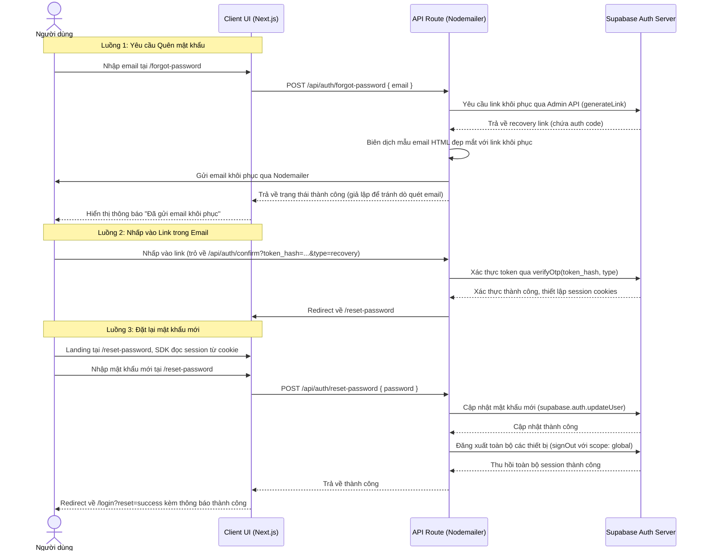

# Thiết kế hệ thống Đặt lại mật khẩu (Password Reset Flow)

Tài liệu này đặc tả luồng nghiệp vụ, giao diện (UI) và API cho tính năng Quên/Đặt lại mật khẩu của ứng dụng AntBiz (Bento Studio).

## 1. Tổng quan Luồng Nghiệp vụ (Data Flow Diagram)



---

## 2. Đặc tả Giao diện (UI Pages)

### A. Trang Quên mật khẩu (`/forgot-password`)
*   **Đường dẫn**: [app/(auth)/forgot-password/page.tsx](file:///d:/Web/AntBiz-/app/(auth)/forgot-password/page.tsx)
*   **Layout**: Kế thừa `AuthLayout` của hệ thống (nền sáng nhạt, bo cong góc, đổ bóng).
*   **Trực quan**: Đồng bộ với trang Login/Register, chia đôi màn hình: bên trái hình ảnh bento studio tối giản, bên phải là form.
*   **Form**:
    *   Trường nhập: `Email` (Zod validation: bắt buộc nhập, đúng định dạng email).
    *   Nút bấm: "Gửi yêu cầu" (Hiệu ứng hover mượt mà, trạng thái loading disabled).
    *   Liên kết: "Quay lại Đăng nhập" quay về `/login`.
*   **Trạng thái Thành công**: Ẩn form và hiển thị giao diện thông báo hoạt họa chúc mừng nhẹ nhàng: *"Chúng tôi đã gửi email đặt lại mật khẩu đến địa chỉ email của bạn..."*

### B. Trang Đặt lại mật khẩu (`/reset-password`)
*   **Đường dẫn**: [app/(auth)/reset-password/page.tsx](file:///d:/Web/AntBiz-/app/(auth)/reset-password/page.tsx)
*   **Bảo vệ**: Chỉ cho phép truy cập nếu người dùng đã có session tạm thời từ Supabase sau khi click email link (Nếu không có, redirect về `/login`).
*   **Form**:
    *   Trường nhập: `Mật khẩu mới` (Kiểm tra độ dài >= 8, chứa chữ hoa, chữ thường, số). Có nút ẩn/hiện mật khẩu.
    *   Trường nhập: `Xác nhận mật khẩu` (Kiểm tra trùng khớp mật khẩu mới).
    *   Nút bấm: "Cập nhật mật khẩu".
*   **Trạng thái Thành công**: Gọi API cập nhật và redirect sang `/login?reset=success`.

---

## 3. Đặc tả API Endpoints

### A. API Yêu cầu Reset (`POST /api/auth/forgot-password`)
*   **Mục đích**: Nhận email từ người dùng, sinh link reset từ Supabase Admin và gửi đi qua Nodemailer.
*   **Body Request**:
    ```json
    { "email": "user@example.com" }
    ```
*   **Logic xử lý**:
    1.  Validate email bằng Zod.
    2.  Khởi tạo Supabase Admin Client (dùng `SUPABASE_SERVICE_ROLE_KEY`).
    3.  Tạo link khôi phục:
        ```typescript
        const { data, error } = await supabaseAdmin.auth.admin.generateLink({
          type: 'recovery',
          email
        });
        ```
    4.  Tạo link xác thực nội bộ: `${origin}/api/auth/confirm?token_hash=${data.properties.hashed_token}&type=recovery&next=/reset-password`
    5.  Nếu sinh link thành công, dùng Nodemailer kết nối SMTP Gmail gửi email với mẫu HTML.
    5.  **Bảo mật**: Dù email có tồn tại trên hệ thống hay không, API vẫn trả về thông báo thành công `200` chung chung để tránh lỗ hổng dò quét tài khoản (User Enumeration).
*   **Response (200 OK)**:
    ```json
    { "message": "Nếu tài khoản tồn tại, email khôi phục đã được gửi đi." }
    ```

### B. API Đặt lại mật khẩu (`POST /api/auth/reset-password`)
*   **Mục đích**: Nhận mật khẩu mới, cập nhật lên Supabase Auth và thu hồi toàn bộ session.
*   **Body Request**:
    ```json
    { "password": "NewSecurePassword123" }
    ```
*   **Logic xử lý**:
    1.  Validate mật khẩu (Zod schema giống lúc đăng ký).
    2.  Khởi tạo Supabase Server Client thông thường (để đọc cookie session hiện tại).
    3.  Kiểm tra session hiện tại, nếu chưa đăng nhập trả về `401 Unauthorized`.
    4.  Cập nhật mật khẩu mới:
        ```typescript
        const { error: updateError } = await supabase.auth.updateUser({
          password: password
        });
        ```
    5.  Sau khi cập nhật thành công, gọi lệnh đăng xuất toàn cục để thu hồi tất cả JWT và session:
        ```typescript
        await supabase.auth.signOut({ scope: 'global' });
        ```
    6.  Xóa cookie auth phía client (Supabase tự động xử lý khi signOut).
*   **Response (200 OK)**:
    ```json
    { "success": true, "message": "Mật khẩu đã được cập nhật và tất cả thiết bị đã được đăng xuất." }
    ```

---

## 4. Thiết kế Mẫu Email (Email Template)
Mẫu email sẽ là code HTML tĩnh inline CSS sử dụng hệ màu Bento Studio (#3F40E8, #0C121E) bao gồm:
*   Logo/Brand name: **Bento Studio**
*   Lời chào cá nhân hóa.
*   Nút bấm nổi bật (CTA) màu tím ánh xanh để đặt lại mật khẩu.
*   Link dự phòng dạng text nếu nút bấm không hoạt động.
*   Cảnh báo bảo mật: *"Nếu bạn không yêu cầu đặt lại mật khẩu, vui lòng bỏ qua email này."*

---

## 5. Cấu hình môi trường (.env)
Bổ sung các tham số cấu hình sau:
```env
# Supabase Service Role Key (Dùng để sinh link recovery)
SUPABASE_SERVICE_ROLE_KEY=your-supabase-service-role-key

# Cấu hình SMTP gửi mail qua Nodemailer
SMTP_HOST=smtp.gmail.com
SMTP_PORT=587
SMTP_USER=your-email@gmail.com
SMTP_PASSWORD=your-gmail-app-password
SMTP_FROM="Bento Studio <noreply@bentostudio.com>"
```
il.com
SMTP_PASSWORD=your-gmail-app-password
SMTP_FROM="Bento Studio <noreply@bentostudio.com>"
```
