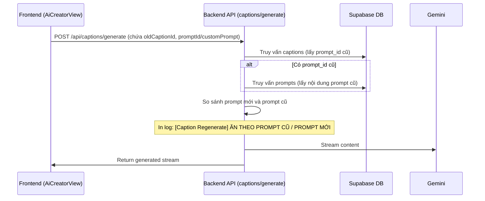

# Tài liệu thiết kế: Cơ chế log so sánh Prompt cũ và mới khi tái sinh Caption

Tài liệu này mô tả chi tiết phương án 1 để ghi nhận logs trên server nhằm xác định chính xác caption được tái sinh là do sử dụng prompt cũ hay prompt mới chọn.

## 1. Yêu cầu hệ thống
- **Mục tiêu:** Khi người dùng thực hiện tái sinh (regenerate) bài đăng mạng xã hội (caption) ở bước "Tối ưu hóa bản sao AI" (Step 2 - A/B Test variants), hệ thống phải ghi nhận log vào Server Console để biết rõ caption mới được tạo ra bằng prompt cũ (giữ nguyên) hay prompt mới được chọn.
- **Phạm vi tác động:**
  - Frontend: `components/views/AiCreatorView.tsx` (gửi thêm `oldCaptionId`).
  - Backend: `app/api/captions/generate/route.ts` (nhận `oldCaptionId`, truy vấn DB so sánh và thực hiện log).

## 2. Kiến trúc & Luồng dữ liệu



## 3. Chi tiết các bước triển khai

### Bước 3.1. Cập nhật Frontend (`components/views/AiCreatorView.tsx`)
Tại hàm `handleRegenerateVariant`:
- Lưu lại ID caption cũ từ `variants` state:
  ```typescript
  const oldCaptionId = variants.find((v) => v.id === variantId)?.captionId;
  ```
- Thêm `oldCaptionId` vào tham số body gửi lên `/api/captions/generate`.

### Bước 3.2. Cập nhật Backend (`app/api/captions/generate/route.ts`)
- Nhận `oldCaptionId` từ request body.
- Truy vấn `prompt_id` của caption cũ từ bảng `captions`.
- Nếu có `prompt_id`, truy vấn tiếp nội dung prompt cũ từ bảng `prompts` để so sánh trong trường hợp custom prompt.
- Tiến hành so sánh:
  - Nếu sử dụng `promptId` (Library Prompt): So sánh `promptId` mới truyền lên với `oldCaption.prompt_id`.
  - Nếu sử dụng `customPrompt`: So sánh nội dung text `customPrompt` mới với nội dung của prompt cũ.
- Thực hiện ghi log bằng console log:
  ```typescript
  console.log('[Caption Regenerate] --- So sánh Prompt ---');
  console.log(`- Caption ID cũ: ${oldCaptionId}`);
  console.log(`- Trạng thái: ${isSamePrompt ? 'ĂN THEO PROMPT CŨ' : 'ĂN THEO PROMPT MỚI'}`);
  console.log(`- Chi tiết: Prompt cũ (ID: ${oldPromptId}), Prompt mới (ID: ${newPromptId})`);
  ```

## 4. Kế hoạch kiểm thử (Test Plan)
1. Thực hiện tạo bài viết đầu tiên (Variant A, B) từ một prompt ban đầu.
2. Tại Step 2, đổi prompt trên UI, hoặc nhấn nút Tái sinh.
3. Quan sát server log để kiểm tra xem hệ thống có in log so sánh chính xác prompt cũ/mới hay không.
