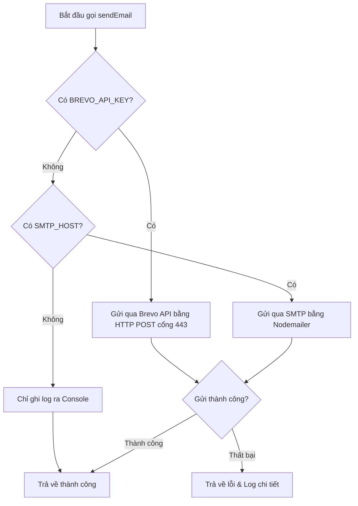

# Tài liệu thiết kế: Tích hợp Brevo HTTPS API gửi Email trên môi trường VPS

Tài liệu này mô tả chi tiết phương án thay thế/nâng cấp cơ chế gửi email hiện tại sang sử dụng Brevo HTTPS API qua cổng 443 nhằm giải quyết triệt để vấn đề VPS chặn các cổng SMTP truyền thống (25, 465, 587).

## 1. Yêu cầu hệ thống
- **Mục tiêu:** Gửi email thông báo kích hoạt tài khoản, khóa/mở khóa tài khoản, hoặc kết quả đăng bài tự động từ môi trường VPS ổn định, không bị chặn tường lửa.
- **Giải pháp:** Sử dụng giao thức HTTPS POST gửi dữ liệu trực tiếp tới API endpoint của Brevo (`https://api.brevo.com/v3/smtp/email`) qua cổng 443 thay vì kết nối SMTP Socket.
- **Phạm vi tác động:** 
  - File tiện ích gửi email: `lib/email.ts`
  - Tệp cấu hình môi trường: `.env` / `.env.local`

## 2. Kiến trúc & Luồng xử lý (Hybrid Email Delivery)

Cơ chế gửi email sẽ hoạt động linh hoạt (Hybrid). Nếu môi trường VPS có API Key của Brevo, hệ thống sẽ ưu tiên gửi qua API. Nếu ở local dev muốn test qua SMTP thông thường hoặc in log ra Console, hệ thống vẫn tự động nhận diện và fallback.



## 3. Cấu hình biến môi trường (.env)

Trên môi trường VPS, cần bổ sung các biến môi trường sau:

```env
# API Key của Brevo (Tạo từ dashboard Brevo > SMTP & API > API Keys)
BREVO_API_KEY=xkeysib-xxxxxxxxxxxxxxxxxxxxxxxxx

# Địa chỉ Email gửi đi (Bắt buộc phải là Sender đã được verify trên Brevo)
BREVO_FROM_EMAIL=no-reply@antbiz.vn

# Tên hiển thị người gửi
BREVO_FROM_NAME="Đội ngũ AntBiz"
```

## 4. Chi tiết mã nguồn triển khai (`lib/email.ts`)

Hàm `sendEmail` được thiết kế lại để nhận biết động cấu hình:

```typescript
export async function sendEmail(options: EmailOptions): Promise<{ success: boolean; error?: string }> {
  console.log(`\n📧 [Email Service] Đang gửi email tới ${options.to}`);
  console.log(`   Tiêu đề: ${options.subject}`);

  const brevoApiKey = process.env.BREVO_API_KEY;

  // ==========================================
  // PHƯƠNG ÁN 1: GỬI QUA BREVO API (CỔNG 443 HTTPS)
  // ==========================================
  if (brevoApiKey) {
    try {
      const fromEmail = process.env.BREVO_FROM_EMAIL || process.env.EMAIL_FROM || 'no-reply@antbiz.vn';
      const fromName = process.env.BREVO_FROM_NAME || 'AntBiz';

      const response = await fetch('https://api.brevo.com/v3/smtp/email', {
        method: 'POST',
        headers: {
          'accept': 'application/json',
          'api-key': brevoApiKey,
          'content-type': 'application/json'
        },
        body: JSON.stringify({
          sender: { name: fromName, email: fromEmail },
          to: [{ email: options.to }],
          subject: options.subject,
          htmlContent: options.html || options.text.replace(/\n/g, '<br/>'),
          textContent: options.text
        })
      });

      if (!response.ok) {
        const errData = await response.json();
        throw new Error(errData.message || `Brevo API error: ${response.status}`);
      }

      console.log(`   ✅ Gửi email thành công qua Brevo API (HTTPS)!`);
      return { success: true };
    } catch (err: any) {
      console.error(`   ❌ Gửi email qua Brevo API thất bại:`, err.message);
      return { success: false, error: err.message };
    }
  }

  // ==========================================
  // PHƯƠNG ÁN 2: SMTP FALLBACK (NODEMAILER)
  // ==========================================
  try {
    const smtpHost = process.env.SMTP_HOST;
    const smtpUser = process.env.SMTP_USER;
    const smtpPass = process.env.SMTP_PASS || process.env.SMTP_PASSWORD;

    if (smtpHost && smtpUser && smtpPass) {
      try {
        const nodemailer = await import('nodemailer');
        const transporter = nodemailer.createTransport({
          host: smtpHost,
          port: parseInt(process.env.SMTP_PORT || '587'),
          secure: process.env.SMTP_SECURE === 'true',
          auth: {
            user: smtpUser,
            pass: smtpPass,
          },
        });

        await transporter.sendMail({
          from: process.env.EMAIL_FROM || process.env.SMTP_FROM || 'no-reply@antbiz.vn',
          to: options.to,
          subject: options.subject,
          text: options.text,
          html: options.html,
        });

        console.log(`   ✅ Gửi email thành công qua SMTP!`);
      } catch (err: any) {
        console.error(`   ❌ Gửi email qua SMTP thất bại:`, err.message);
        return { success: false, error: err.message };
      }
    } else {
      console.log(`   ℹ️ Chưa cấu hình API Key hay SMTP. Email ghi tạm ra console.`);
    }

    return { success: true };
  } catch (error: any) {
    return { success: false, error: error.message };
  }
}
```

## 5. Kế hoạch kiểm thử (Test Plan)

Để kiểm tra hệ thống gửi email hoạt động ổn định và chính xác theo cấu hình ưu tiên (Brevo API -> SMTP -> Console), lập trình viên có thể thực hiện kiểm thử nhanh trên môi trường local thông qua tệp API test tạm thời: `app/api/test-email/route.ts`.

### Bước chuẩn bị: Cấu hình môi trường (.env)
Trước khi test, hãy điều chỉnh file `.env` ở local để chọn luồng muốn kiểm thử:
- **Test luồng Brevo API:** Khai báo khóa `BREVO_API_KEY`, `BREVO_FROM_EMAIL`, `BREVO_FROM_NAME`.
- **Test luồng SMTP (Nodemailer):** Đảm bảo `SMTP_HOST` được khai báo, đồng thời tắt/comment dòng `BREVO_API_KEY`.
- **Test luồng Console Log:** Xóa/comment cả `BREVO_API_KEY` và `SMTP_HOST`.

---

### Cách 1: Sử dụng Trình duyệt Web (Web Browser)
Phương pháp này phù hợp để kiểm tra trực quan, nhanh chóng.

1. **Khởi chạy ứng dụng:** Đảm bảo dự án đang chạy ở chế độ phát triển bằng lệnh `npm run dev`.
2. **Nhập URL:** Mở trình duyệt (Chrome/Edge/Firefox) và truy cập đường dẫn sau:
   ```
   http://localhost:3000/api/test-email?to=your_email@gmail.com
   ```
   *(Thay `your_email@gmail.com` bằng địa chỉ email cá nhân thực tế của bạn).*
3. **Kiểm tra kết quả trên giao diện:** Trình duyệt sẽ hiển thị phản hồi JSON dạng:
   ```json
   {
     "message": "Yêu cầu gửi email đã được xử lý",
     "result": { "success": true },
     "detected_config": { "has_brevo_key": true, "has_smtp_host": false }
   }
   ```
4. **Kiểm tra Terminal logs:** Xem console đang chạy `npm run dev` để kiểm tra dòng log:
   `✅ Gửi email thành công qua Brevo API (HTTPS)!` hoặc log tương ứng.
5. **Kiểm tra hộp thư:** Mở hòm thư của bạn để xác nhận email đã được gửi đến thành công.

---

### Cách 2: Sử dụng Postman
Phương pháp này giúp kiểm tra chi tiết các tham số HTTP, Headers và mã trạng thái phản hồi.

1. **Khởi động Postman:** Mở ứng dụng Postman trên máy tính của bạn.
2. **Tạo Request mới:**
   - **Method:** Chọn `GET` trong ô phương thức.
   - **Request URL:** Điền `http://localhost:3000/api/test-email`.
3. **Cấu hình Params:**
   - Chuyển sang tab **Params** bên dưới thanh nhập URL.
   - Thêm một dòng mới:
     - **Key:** `to`
     - **Value:** Điền email nhận thực tế của bạn (Ví dụ: `nguyen@gmail.com`).
   - Lúc này, Postman sẽ tự động sinh URL hoàn chỉnh: `http://localhost:3000/api/test-email?to=nguyen@gmail.com`.
4. **Gửi Request:** Nhấn nút **Send** màu xanh.
5. **Đọc phản hồi (Response):**
   - **Status Code:** Đảm bảo mã trả về là `200 OK`.
   - **Body:** Định dạng chọn `JSON`. Kết quả sẽ trả về thông tin cấu hình mà hệ thống nhận diện cùng trạng thái gửi email `result.success: true`.
6. **Kiểm tra Logs & Hộp thư:** Kiểm tra logs hiển thị tại cửa sổ terminal và kiểm tra hòm thư của bạn tương tự như Cách 1.

---

### Bước dọn dẹp sau khi kiểm thử thành công
Sau khi hoàn tất kiểm thử và xác nhận luồng Brevo API hoạt động hoàn hảo, hãy xóa tệp API test tạm thời này khỏi dự án để tránh lỗ hổng bảo mật khi deploy lên VPS:
```powershell
rm app/api/test-email/route.ts
```
