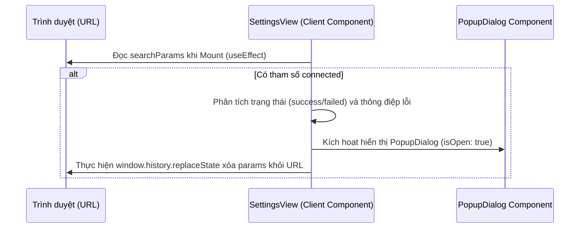

# Thiết kế Kỹ thuật: Cảnh báo và Thông báo Trực quan khi Kết nối Mạng xã hội

Tài liệu này đặc tả thiết kế và kế hoạch tích hợp cơ chế thông báo trạng thái kết nối OAuth và kiểm soát tính khả dụng của tài khoản mạng xã hội khi soạn thảo/lên lịch đăng bài viết.

---

## 1. Mục tiêu (Objectives)
*   **Thông báo trạng thái OAuth (Trang Cài đặt)**: Hiển thị Popup thông báo rõ ràng (Thành công / Thất bại kèm lý do chi tiết từ Meta) khi người dùng được chuyển hướng trở lại trang Cài đặt sau luồng xác thực tài khoản. Tự động làm sạch thanh địa chỉ URL để tránh lặp lại thông báo khi tải lại trang.
*   **Cảnh báo kết nối (AI Creator)**: Kiểm tra trạng thái liên kết tài khoản trước khi cho phép người dùng sinh nội dung hoặc lên lịch đăng bài. Hiển thị nhãn cảnh báo trực quan "Chưa kết nối" trên danh sách chọn kênh và cung cấp liên kết nhanh đến trang Cài đặt để hoàn tất kết nối.

---

## 2. Thiết kế Luồng Dữ liệu & UI/UX

### 2.1. Nhận biết và hiển thị kết quả OAuth (SettingsView)
Khi Meta API Callback (`/api/auth/[platform]/callback`) redirect về `/settings`, nó sẽ đính kèm các tham số:
*   Thành công: `/settings?connected=success&platform=facebook`
*   Thất bại: `/settings?connected=failed&platform=facebook&error=Tài khoản không quản lý Page nào`

**Luồng xử lý tại Frontend (`SettingsView.tsx`):**


### 2.2. Kiểm soát kết nối trong AI Creator (`AiCreatorView.tsx`)
Khi người dùng tải trang AI Creator:
1.  **Tải trạng thái**: Gọi API `GET /api/linked-accounts` để lấy danh sách các tài khoản MXH đã kết nối của người dùng hiện tại.
2.  **Đánh dấu trực quan**: 
    *   Bên cạnh mỗi ô chọn (Checkbox) nền tảng trong danh sách: Nếu nền tảng chưa được liên kết, hiển thị một badge màu đỏ: `"Chưa kết nối"`.
3.  **Chặn hành động lỗi**:
    *   Khi người dùng nhấn **"Sinh nội dung"** (ở Bước 1) hoặc **"Xác nhận lên lịch"** (ở Bước 2).
    *   Hệ thống kiểm tra các nền tảng đang được chọn trong mảng `selectedPlatforms`.
    *   If có bất kỳ nền tảng nào chưa kết nối: Chặn tiến trình, hiển thị một `PopupDialog` cảnh báo với nội dung: *"Vui lòng liên kết tài khoản [Tên nền tảng] trong trang Cài đặt trước khi tiến hành tạo bài viết."*

---

## 3. Cấu trúc Component & Thay đổi Code

### 3.1. Trang Cài đặt (`components/views/SettingsView.tsx`)
*   **Component sử dụng**: `PopupDialog` từ `@/components/PopupDialog`.
*   **State mới**:
    ```typescript
    const [popupOpen, setPopupOpen] = useState(false);
    const [popupMessage, setPopupMessage] = useState("");
    const [popupType, setPopupType] = useState<'success' | 'error'>('success');
    const [popupTitle, setPopupTitle] = useState("");
    ```
*   **Logic đọc tham số URL (`useEffect`)**:
    ```typescript
    useEffect(() => {
      const params = new URLSearchParams(window.location.search);
      const connected = params.get('connected');
      const platform = params.get('platform');
      const errorMsg = params.get('error');

      if (connected) {
        const platformLabel = platform === 'threads' || platform === 'thread' ? 'Meta Threads' : 
                              platform === 'instagram' ? 'Instagram Business' : 'Facebook Page';
        
        if (connected === 'success') {
          setPopupType('success');
          setPopupTitle(language === 'vi' ? 'Liên kết thành công' : 'Connection Success');
          setPopupMessage(
            language === 'vi' 
              ? `Tài khoản ${platformLabel} của bạn đã được kết nối thành công.` 
              : `${platformLabel} account has been connected successfully.`
          );
        } else {
          setPopupType('error');
          setPopupTitle(language === 'vi' ? 'Liên kết thất bại' : 'Connection Failed');
          setPopupMessage(
            language === 'vi'
              ? `Không thể liên kết ${platformLabel}. Chi tiết: ${decodeURIComponent(errorMsg || 'Lỗi không xác định')}`
              : `Failed to link ${platformLabel}. Detail: ${decodeURIComponent(errorMsg || 'Unknown error')}`
          );
        }
        setPopupOpen(true);

        // Làm sạch thanh địa chỉ URL
        const newUrl = window.location.pathname;
        window.history.replaceState({}, document.title, newUrl);
      }
    }, [language]);
    ```

### 3.2. Trang AI Creator (`components/views/AiCreatorView.tsx`)
*   **State mới**:
    ```typescript
    const [connectedPlatforms, setConnectedPlatforms] = useState<string[]>([]);
    ```
*   **Logic tải tài khoản khi Mount**:
    ```typescript
    useEffect(() => {
      const fetchConnections = async () => {
        try {
          const res = await fetch('/api/linked-accounts');
          if (res.ok) {
            const json = await res.ok ? await res.json() : { data: [] };
            const platforms = (json.data || []).map((acc: any) => acc.platform); // 'facebook', 'instagram', 'thread'
            setConnectedPlatforms(platforms);
          }
        } catch (err) {
          console.error('Error checking platform integrations:', err);
        }
      };
      fetchConnections();
    }, []);
    ```
*   **Logic chặn hành động**:
    *   Hàm `handleGenerate` (hoặc `streamVariant`): Kiểm tra xem các kênh trong `selectedPlatforms` có nằm trong mảng `connectedPlatforms` hay không (lưu ý đồng bộ tên định danh `'thread'` và `'threads'`).
    *   Nếu thiếu kết nối, hiển thị `PopupDialog` cảnh báo và dừng thực thi.

---

## 4. Kịch bản Kiểm thử (Test Cases)
1.  **Test thông báo thành công**: Truy cập `/settings?connected=success&platform=threads`. Kết quả mong đợi: Popup thành công trượt ra từ góc màn hình, URL tự động chuyển về `/settings`.
2.  **Test thông báo thất bại kèm chi tiết lỗi**: Truy cập `/settings?connected=failed&platform=facebook&error=Tài khoản Facebook này không quản lý Page nào`. Kết quả mong đợi: Popup màu đỏ trượt ra hiển thị đúng thông tin lỗi trên, URL tự động làm sạch.
3.  **Test kiểm soát trong AI Creator**: Vào AI Creator, chọn một nền tảng chưa được kết nối trong Cài đặt. Kết quả mong đợi: Hiển thị badge màu đỏ *"Chưa kết nối"* bên cạnh tên nền tảng. Khi bấm "Sinh nội dung", tiến trình bị chặn và xuất hiện Popup thông báo hướng dẫn người dùng liên kết tài khoản trước.
