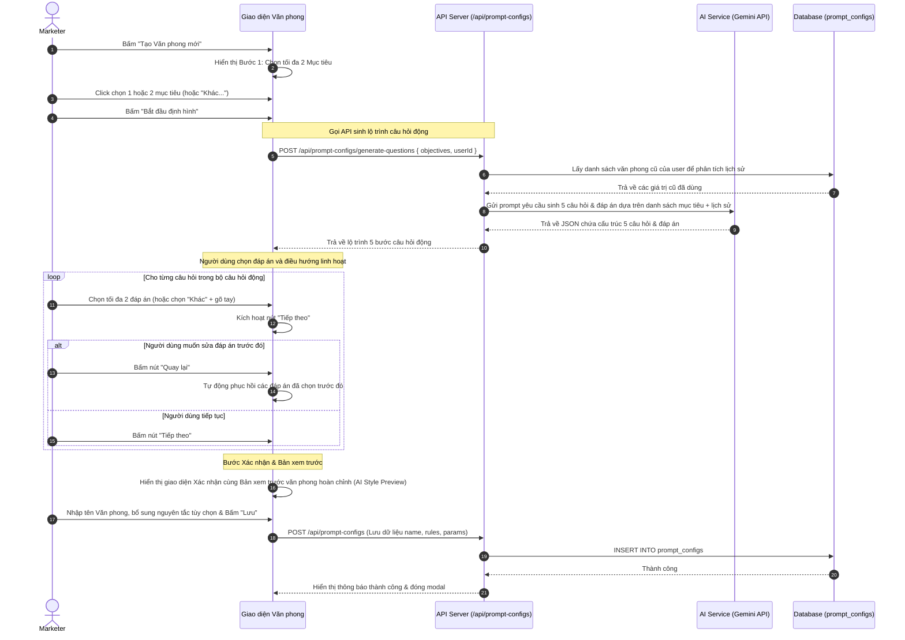

# Đặc tả Thiết kế: Kiến tạo Văn phong Thương hiệu Tương tác AI (Brand Style Wizard)

Tài liệu này đặc tả thiết kế cho tính năng Quản lý & Kiến tạo Văn phong Thương hiệu (trước đây gọi là Presets), tích hợp cơ chế sinh lộ trình câu hỏi động qua AI và lưu trữ đồng bộ trong bảng `prompt_configs`.

---

## 1. Tổng quan Tính năng (Overview)

Mục tiêu là hỗ trợ Marketer kiến tạo **Văn phong thương hiệu** cá nhân hoá bằng cách trả lời một bộ câu hỏi tương tác ngắn gọn (tối đa 6 câu hỏi). Để giảm thiểu thao tác gõ tay và tăng tính phù hợp:
- **Câu hỏi 1 (Cố định):** Chọn các mục tiêu cốt lõi của văn phong (Bán hàng, Tuyển dụng, Tương tác...). **Người dùng được phép chọn tối đa 2 mục tiêu cùng lúc** để AI có định hướng đa chiều nhưng vẫn tập trung.
- **Câu hỏi tiếp theo (Động qua AI - Số lượng từ 3 đến 6 câu):** Sau khi chọn xong câu 1, AI sẽ phân tích các mục tiêu đã chọn cùng với lịch sử các văn phong trước đó để tự động quyết định số lượng câu hỏi cần thiết (từ 3 đến 6 câu hỏi) nhằm thu thập đủ thông tin hành văn. Mỗi câu hỏi đi kèm 4 phương án gợi ý sẵn + 1 phương án "Khác" (cho phép gõ tay).
- **Tối ưu hiệu năng:** Sinh toàn bộ lộ trình câu hỏi trong **một API call duy nhất** để triệt tiêu độ trễ tải dữ liệu giữa các bước.
- **Biên dịch Quy tắc AI:** Kết hợp tất cả các câu trả lời trắc nghiệm và nguyên tắc bổ sung thành một chỉ dẫn viết bài hoàn chỉnh dưới dạng JSON chứa quy tắc chung và quy tắc cho từng nền tảng (Facebook, Instagram, Threads).

---

## 2. Cấu trúc Dữ liệu & Lưu trữ (Database Schema)

Văn phong thương hiệu được lưu vào bảng `prompt_configs` thay thế cho bảng `prompts` cũ.

### Bảng `public.prompt_configs`
| Cột | Kiểu dữ liệu | Mô tả |
| :--- | :--- | :--- |
| `id` | `UUID` | Khóa chính (Tự động sinh). |
| `user_id` | `UUID` | ID của người dùng sở hữu (Khóa ngoại đến `users.id`). |
| `name` | `TEXT` | Tên gợi nhớ của Văn phong (do người dùng đặt). |
| `is_default`| `BOOLEAN` | Đánh dấu văn phong mặc định của người dùng này. |
| `rules` | `TEXT` | Chuỗi JSON chứa chỉ dẫn viết bài biên dịch (Platform style schema). |
| `params` | `JSONB` | Chứa dữ liệu câu hỏi và câu trả lời để hiển thị lại khi Sửa/Xem. |
| `created_at`| `TIMESTAMPTZ`| Thời gian tạo. |
| `updated_at`| `TIMESTAMPTZ`| Thời gian cập nhật cuối cùng. |

### Chi tiết Cấu trúc Cột `params`
Cột `params` lưu giữ lộ trình câu hỏi và các cấu hình mềm bổ sung để đảm bảo khi bấm **Chỉnh sửa**, giao diện có thể hiển thị lại chính xác câu hỏi động và nhập liệu của người dùng:
```json
{
  "questionnaireAnswers": {
    "objectives": ["Quảng bá & Bán hàng", "Xây dựng nhận diện thương hiệu"],
    "additionalRules": "Không viết tắt, không dùng các chủ đề nhạy cảm, tập trung nhắc đến giá trị trải nghiệm sản phẩm.",
    "steps": [
      {
        "key": "persona",
        "question": "Danh xưng thương hiệu đóng vai trò gì khi viết bài?",
        "answer": "Người bán hàng năng động",
        "options": ["Người bán hàng năng động", "Chuyên gia tư vấn", "Người bạn đồng hành", "Nhà sáng lập truyền cảm hứng"]
      },
      {
        "key": "pronoun",
        "question": "Cặp xưng hô chủ đạo giữa thương hiệu và khách hàng là gì?",
        "answer": "Em - Anh/Chị",
        "options": ["Em - Anh/Chị", "Mình - Bạn", "Admin - Quý khách", "Tớ - Cậu"]
      },
      {
        "key": "tone",
        "question": "Tông giọng cảm xúc nào là chủ đạo trong bài viết?",
        "answer": "Hào hứng & Thuyết phục",
        "options": ["Thân thiện & Gần gũi", "Chuyên nghiệp & Đáng tin", "Hào hứng & Thuyết phục", "Hài hước & Dí dỏm"]
      },
      {
        "key": "emoji",
        "question": "Quy tắc sử dụng emoji (biểu tượng cảm xúc) thế nào?",
        "answer": "Dùng vừa phải để nhấn mạnh thông tin",
        "options": ["Dùng nhiều sinh động", "Dùng vừa phải để nhấn mạnh thông tin", "Tối giản & tinh tế", "Không dùng emoji"]
      },
      {
        "key": "hashtag",
        "question": "Cách bố trí hashtag trong bài viết?",
        "answer": "Để tất cả ở cuối bài viết",
        "options": ["Để tất cả ở cuối bài viết", "Lồng ghép tự nhiên trong nội dung câu", "Chỉ dùng hashtag thương hiệu độc quyền", "Không dùng hashtag"]
      }
    ]
  }
}
```

---

## 3. Luồng Nghiệp vụ Chi tiết (Workflow)



---

## 4. Đặc tả API Endpoints

### 4.1. Sinh bộ câu hỏi tương tác AI
- **Endpoint:** `POST /api/prompt-configs/generate-questions`
- **Yêu cầu Quyền:** Marketer hoặc Admin.
- **Request Body:**
  ```json
  {
    "objectives": ["Quảng bá & Bán hàng", "Xây dựng nhận diện thương hiệu"]
  }
  ```
- **Xử lý phía Server:**
  1. Truy vấn các văn phong cũ của người dùng trong bảng `prompt_configs` lọc theo `user_id`.
  2. Tổng hợp tần suất các câu trả lời trước đó (ví dụ ngôi xưng thường dùng nhất, tông giọng hay dùng...).
  3. Gửi prompt đến Gemini API yêu cầu tạo bộ câu hỏi dạng trắc nghiệm thích ứng với danh sách mục tiêu đã chọn (tối đa 2 mục tiêu). Số lượng câu hỏi sẽ do AI tự đề xuất từ **3 đến 6 câu hỏi** dựa trên độ phức tạp của mục tiêu, ưu tiên lồng ghép hoặc sắp xếp các câu trả lời quen thuộc trong lịch sử người dùng lên vị trí gợi ý đầu tiên.
- **Response (200 OK):**
  ```json
  {
    "steps": [
      {
        "key": "persona",
        "question": "Danh xưng thương hiệu đóng vai trò gì khi viết bài?",
        "options": ["Người bán hàng năng động", "Chuyên gia tư vấn", "Người bạn đồng hành", "Nhà sáng lập truyền cảm hứng"]
      },
      ...
    ]
  }
  ```

---

## 5. Thuật toán Sinh quy tắc AI (Compilation Algorithm)

Khi người dùng lưu Văn phong, hệ thống sẽ gọi hàm biên dịch để chuyển đổi các câu trả lời thành chuỗi JSON `rules` tương thích ngược:
```typescript
function compileBrandStyleRules(answers: {
  objectives: string[];
  persona: string;
  pronoun: string;
  tone: string;
  emoji: string;
  hashtag: string;
  additionalRules?: string;
}): string {
  let general = `Bạn đóng vai trò là ${answers.persona}. 
Mục tiêu cốt lõi của bài viết là: ${answers.objectives.join(', ')}. 
Hãy xưng hô với người đọc là ${answers.pronoun}. 
Hành văn với tông giọng ${answers.tone}. 
Quy tắc sử dụng Emoji: ${answers.emoji}. 
Quy tắc gắn Hashtag: ${answers.hashtag}.`;

  if (answers.additionalRules && answers.additionalRules.trim()) {
    general += `\nLưu ý và nguyên tắc bổ sung: ${answers.additionalRules.trim()}`;
  }

  const facebook = "Hành văn thu hút, chia đoạn rõ ràng bằng ký tự dòng trống, sử dụng emoji làm ký tự đầu dòng để tăng sự nổi bật trực quan.";
  const instagram = "Viết ngắn gọn, súc tích, chú trọng tính thẩm mỹ của ngôn từ, đặt hashtag xuống cuối bài viết.";
  const threads = "Viết ngắn gọn, mang văn phong đời thường, thân mật, kích thích thảo luận tương tác dưới phần bình luận, hạn chế dùng emoji và hashtag.";

  return JSON.stringify({
    general,
    facebook,
    instagram,
    threads
  });
}
```

---

## 6. Thiết kế Giao diện Người dùng (UI/UX)

- **Danh sách Văn phong (Listing View):**
  - Hiển thị danh sách Văn phong dưới dạng thẻ tóm tắt (File Card) cực kỳ tối giản và có chiều cao cố định đồng bộ.
  - Mỗi thẻ chỉ chứa Tên văn phong, nhãn "Mặc định" (nếu có), các mục tiêu dưới dạng thẻ tag `🎯 [Mục tiêu]` xếp gọn gàng và Platform Icon tương ứng. Không hiển thị nội dung quy tắc chữ thô trên thẻ.
  - Toàn bộ thẻ đóng vai trò là một vùng nhấp chuột (Clickable Card). Nhấn vào thẻ sẽ hiển thị hộp thoại xem chi tiết (Detail Modal) với đầy đủ quy tắc. Khi hover vào thẻ, kích thước sẽ phóng to nhẹ (`scale-[1.01]`) cùng hiệu ứng viền sáng và xuất hiện icon Phóng to/Xem chi tiết ở góc.
  - Thẻ chỉ hỗ trợ đầy đủ các thao tác CRUD cơ bản: Sửa nhanh và Xóa trực tiếp thông qua menu ba chấm rút gọn (Đã loại bỏ chức năng Nhân bản để tinh gọn quy trình).
- **Giao diện Modal Xem chi tiết (Detail Modal):**
  - Hiển thị đầy đủ thông tin của Văn Phong được lưu trữ gồm: Tên, Nền tảng, Trạng thái Mặc định, Các Mục tiêu.
  - Các chỉ dẫn hành văn được cấu trúc hóa dưới dạng danh sách chia hàng ngang sạch sẽ, phân tách từng quy tắc rõ ràng kèm bullet point để tối ưu khả năng đọc. Phần quy tắc bổ sung sẽ hiển thị ở một khung dưới cùng.
- **Giao diện Modal tạo/sửa:**
  - **Bước 1 (Chọn Mục tiêu):**
    - Hiển thị các hộp chọn dạng lưới kèm icon sinh động.
    - Cho phép chọn tối đa 2 mục tiêu. Khi đã chọn đủ 2 mục tiêu, các hộp chọn chưa được chọn sẽ mờ đi và bị vô hiệu hóa (disabled).
    - Thẻ "Khác..." được tính là 1 slot mục tiêu. Khi chọn "Khác...", hiển thị trường nhập text mềm mại trượt xuống ngay bên dưới lưới. Người dùng bắt buộc phải điền nội dung tự nhập để nút tiếp tục có hiệu lực.
    - Dưới chân bước này hiển thị nút **"Bắt đầu định hình (Tiếp theo)"**, nút này chỉ sáng lên khi người dùng đã chọn ít nhất 1 mục tiêu (và đã điền text tự nhập nếu có chọn "Khác...").
  - **Trạng thái Chờ (Loading State & UX Perceived Latency):** 
    - Khi bấm "Bắt đầu định hình", hiển thị một màn hình chờ chuyển tiếp mượt mà có hiệu ứng lấp lánh (Sparkles) kết hợp spinner xoay tròn.
    - Để giải quyết cảm nhận thời gian chờ đợi (perceived latency), dòng trạng thái thông tin sẽ tự động xoay vòng thay đổi sau mỗi 2 giây nhằm mô tả chân thực tiến trình xử lý của AI (Ví dụ: *"Đang kết nối..."*, *"Đang phân tích mục tiêu..."*, *"Đang tối ưu lộ trình..."*, *"Đang chuẩn bị câu hỏi..."*).
  - **Các bước câu hỏi động (Số lượng linh hoạt từ 3 đến 6 câu):**
    - Hiển thị thanh tiến trình trực quan dạng phần trăm hoặc `currentStep / totalSteps` thích ứng linh hoạt với số lượng câu hỏi nhận về từ API.
    - Cung cấp 4 nút phương án lớn bấm trực tiếp + 1 nút "Khác". Khi bấm "Khác", hiển thị một trường nhập text nhỏ để điền tay.
    - **Cơ chế Chọn nhiều & Giới hạn (Max 2):** Cho phép chọn tối đa 2 đáp án cho mỗi câu hỏi. Khi đã chọn đủ 2 đáp án, các đáp án chưa được chọn khác sẽ bị vô hiệu hóa (disabled) và làm mờ (opacity-40). Lựa chọn "Khác" và trường tự nhập chiếm 1 slot lựa chọn.
    - **Cơ chế Điều hướng & Ghi nhớ lựa chọn:** 
      - Không tự động chuyển câu hỏi khi bấm chọn để tránh mất cơ hội chọn sắc thái thứ 2. Người dùng sẽ bấm nút **"Quay lại"** (bên góc trái) để lùi bước hoặc **"Tiếp theo"** (bên góc phải) để chuyển sang câu kế tiếp.
      - Khi người dùng nhấn "Quay lại", hệ thống tự động tải và hiển thị chính xác các đáp án đã được tick chọn hoặc nội dung nhập tay trước đó.
      - Nút "Tiếp theo" chỉ được kích hoạt khi người dùng đã chọn ít nhất 1 đáp án (và điền đầy đủ text tự nhập nếu có chọn "Khác").
  - **Bước xác nhận:** 
    - Nhập tên Văn phong thương hiệu.
    - Cung cấp một ô nhập liệu lớn (textarea) cho phép người dùng tự điền các **"Lưu ý & Nguyên tắc bổ sung"** (Custom Rules) mong muốn (Ví dụ: "Không được viết tắt", "Không viết hoa toàn bộ chữ").
    - **Bản xem trước Văn phong hoàn chỉnh (AI Style Preview):** Hiển thị một khung đọc-hiển thị thông tin được cập nhật theo thời gian thực (real-time compiled preview), biểu diễn chi tiết văn phong hoàn chỉnh dạng danh sách gạch đầu dòng (Mục tiêu đã chọn, Các nét tính cách pha trộn từ câu hỏi, và các nguyên tắc bổ sung do người dùng nhập).
    - Tùy chọn bật/tắt làm mặc định, xem trước chỉ dẫn AI được biên dịch và lưu lại.

---

## 7. Tối ưu hóa Hiệu năng & Tốc độ sinh (Model & Performance Tuning)

Để đảm bảo trải nghiệm sinh câu hỏi động diễn ra nhanh nhất, giảm thiểu tối đa độ trễ phản hồi (latency), hệ thống được cấu hình tối ưu như sau:
- **Lựa chọn Model:** Thay vì sử dụng các dòng model lớn, nặng hoặc thử nghiệm như `gemini-2.5-flash` / `gemini-3.5-flash` làm mặc định, module Prompt Config chuyển hướng sử dụng **`gemini-3.1-flash-lite`** làm cấu hình mặc định (có hỗ trợ ghi đè qua biến môi trường `GEMINI_PROMPT_MODEL`). Điều này giúp tốc độ khởi tạo (cold start) và tốc độ sinh chuỗi giảm từ 6-8 giây xuống chỉ còn 1.5-2.5 giây.
- **Tối ưu hóa Generation Parameters:** 
  - Đặt `temperature: 0.1` đối với JSON Mode để tăng tính nhất quán và đẩy nhanh thời gian tạo cấu trúc cây câu hỏi.
  - Đặt `temperature: 0.2` đối với các luồng sinh văn bản thông thường của module Prompt Config.
- **Lớp Làm sạch dữ liệu Robust Parser:** Tích hợp hàm `cleanAndParseJSON` tự động dọn dẹp các ký tự markdown thừa, khoảng trắng và dấu phẩy dư thừa ở cuối mảng/đối tượng để tránh gây lỗi JSON.parse.

