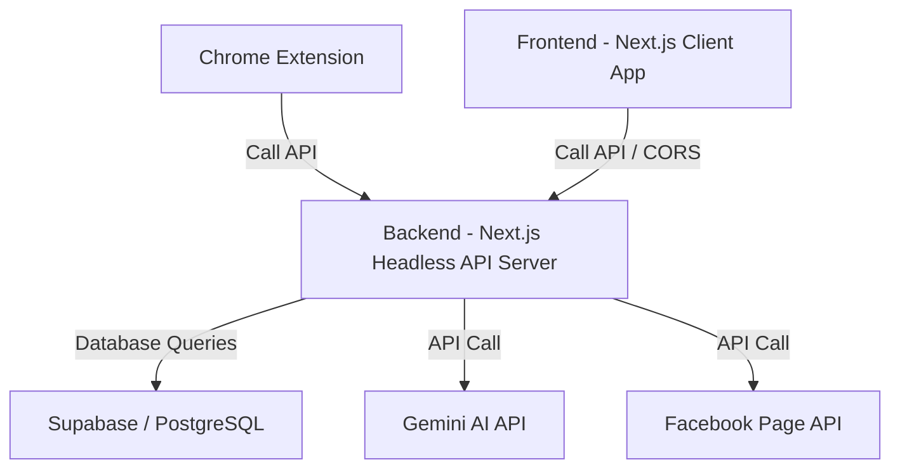

# Kế hoạch Tách biệt Codebase AntBiz thành Frontend và Backend độc lập (Sử dụng Next.js cho cả hai)

Tài liệu này phác thảo mô hình kiến trúc, cấu trúc thư mục đề xuất và quy trình thực hiện để tách biệt hệ thống AntBiz hiện tại (đang là Next.js Fullstack) thành hai dự án độc lập, trong đó **cả hai đều sử dụng Next.js**:
1. **Frontend (Next.js Client)**: Chuyên trách giao diện (pages, components, RSC, Client Components).
2. **Backend (Next.js Headless API Server)**: Chuyên trách các API Route Handlers (`/api/...`), cào báo, AI Engine, Scheduler và kết nối Database.

---

## I. Phân tích Hiện trạng (Current Codebase)
Hiện tại, AntBiz đang chạy dưới dạng một ứng dụng Next.js Fullstack tích hợp:
- **Frontend**: Sử dụng React Server Components (RSC) kết hợp Client Components trong thư mục `app/` (các trang UI) và `components/`.
- **Backend**: Các API Routes viết bằng Next.js Route Handlers nằm trong các thư mục `app/api/...`. Logic dùng chung, kết nối cơ sở dữ liệu và gọi AI/mạng xã hội nằm trong `lib/` và `utils/`.
- **Chrome Extension**: Một codebase phụ kết nối trực tiếp với các endpoint của server thông qua API.

---

## II. Kiến trúc Đề xuất sau khi Tách (Target Architecture)

Sau khi tách, hệ thống sẽ gồm 2 dự án Next.js độc lập chạy ở 2 cổng hoặc domain độc lập (ví dụ: Frontend chạy ở cổng `3000`, Backend chạy ở cổng `5000` hoặc sub-domain `api.antbiz.vn`):



*Lợi thế khi cả hai đều dùng Next.js*: 
- Giữ nguyên cấu trúc code Route Handlers (`app/api/...`) mà không cần viết lại mã nguồn sang Express/NestJS.
- Tận dụng được các cơ chế nén, xử lý file và tối ưu hóa sẵn có của Next.js cho cả 2 phía.

---

## III. Cấu trúc Thư mục Đề xuất (Proposed Directory Structure)

### 1. Dự án Frontend (antbiz-frontend)
Dự án này là một ứng dụng Next.js chỉ chứa giao diện người dùng, cấu hình trang và component. Các trang sẽ lấy dữ liệu từ Backend thông qua API và không có logic xử lý trực tiếp với Database hay API Keys bí mật.

```text
antbiz-frontend/
├── app/                     # Next.js App Router (Chỉ chứa Trang UI, KHÔNG chứa thư mục api/)
│   ├── (auth)/              # Các trang Login, Register, Reset-password
│   ├── (dashboard)/         # Các trang Dashboard, Overview, Calendar, AI Creator...
│   ├── globals.css          # Style CSS toàn cục
│   ├── layout.tsx           # Layout dùng chung
│   └── page.tsx             # Trang Landing chính
├── components/              # Các Component UI tái sử dụng (Button, Modal, Sidebar...)
│   └── views/               # Các màn hình view lớn (AiCreatorView, Overview, Calendar...)
├── contexts/                # React Contexts quản lý state (AuthContext, ThemeContext...)
├── hooks/                   # Custom React Hooks (useAuth, useFetch...)
├── services/                # Lớp gọi API (axios client, apiClient...)
│   └── apiClient.ts         # Gọi tập trung sang URL của Next.js Backend (NEXT_PUBLIC_API_URL)
├── types/                   # Kiểu dữ liệu TypeScript dùng chung
├── utils/                   # Hàm tiện ích trợ giúp xử lý client-side
├── public/                  # Các tài sản tĩnh (logo, images, icons)
├── .env.example             # Chỉ chứa URL của Backend (NEXT_PUBLIC_API_URL)
├── package.json
├── tailwind.config.ts
└── tsconfig.json
```

### 2. Dự án Backend (antbiz-backend) - Cấu trúc Chuẩn hóa theo mô hình Spring Boot

Dự án này là một ứng dụng Next.js Headless API Server. Để đảm bảo tính phân tách mã nguồn rõ ràng, dễ bảo trì và kế thừa tính chặt chẽ của Java Spring Boot, cấu trúc backend sẽ được tổ chức theo kiến trúc **Controller - Service - Repository (3-Tier Architecture)** tương ứng 1-1 với Spring Boot:

```text
antbiz-backend/
├── app/
│   └── api/                     # ROUTING LAYER (Chỉ làm nhiệm vụ tiếp nhận HTTP request và gọi Controller)
│       ├── auth/
│       │   └── route.ts         # Gọi AuthController
│       ├── prompts/
│       │   └── route.ts         # Gọi PromptController
│       └── captions/
│           └── route.ts         # Gọi CaptionController
├── config/                      # CONFIGURATION LAYER (Tương đương @Configuration trong Spring)
│   ├── db.ts                    # Khởi tạo Supabase Admin Client
│   ├── gemini.ts                # Cấu hình API Key Gemini
│   └── mail.ts                  # Cấu hình SMTP Mailer
├── controller/                  # CONTROLLER LAYER (Tương đương @RestController trong Spring)
│   ├── AuthController.ts        # Tiếp nhận session token, xử lý phân quyền
│   ├── PromptController.ts      # Tiếp nhận yêu cầu sinh bài đăng AI, CRUD prompts
│   └── CaptionController.ts     # Tiếp nhận yêu cầu đăng bài, lên lịch
├── dto/                         # DATA TRANSFER OBJECT (Tương đương các DTO class trong Spring)
│   ├── auth.dto.ts              # Kiểu dữ liệu xác thực đầu vào/đầu ra
│   ├── prompt.dto.ts            # Kiểu dữ liệu Zod validation cho prompt
│   └── caption.dto.ts           # Kiểu dữ liệu Zod validation gửi từ Extension
├── exception/                   # EXCEPTION LAYER (Tương đương Custom Exception & @ControllerAdvice)
│   ├── ApiException.ts          # Lớp Exception chung của hệ thống (chứa status code, message)
│   ├── BadRequestException.ts   # Lỗi dữ liệu không hợp lệ (400)
│   └── GlobalExceptionHandler.ts# Bộ bắt lỗi toàn cục và định dạng JSON lỗi trả về
├── model/                       # MODEL LAYER (Tương đương @Entity / JPA Models trong Spring)
│   ├── Article.ts               # Định nghĩa interface / schema của bảng articles
│   ├── Caption.ts               # Định nghĩa schema bảng captions
│   └── ScheduledPost.ts         # Định nghĩa schema bảng scheduled_posts
├── repository/                  # REPOSITORY LAYER (Tương đương @Repository / JPA Repository trong Spring)
│   ├── ArticleRepository.ts     # Các hàm select, insert, update bảng articles qua Supabase
│   ├── PromptRepository.ts      # Các hàm CRUD bảng prompts
│   └── CaptionRepository.ts     # Các hàm CRUD bảng captions và scheduled_posts
├── service/                     # SERVICE LAYER (Tương đương @Service - Chứa logic nghiệp vụ lõi)
│   ├── GeminiService.ts         # Logic kết nối Gemini AI sinh bài viết
│   ├── CrawlerService.ts        # Logic Playwright cào bài viết tự động
│   └── MailService.ts           # Logic gửi mail báo cáo hệ thống
├── scheduler/                   # SCHEDULER LAYER (Tương đương @Scheduled trong Spring)
│   └── PublishScheduler.ts      # Chạy tác vụ ngầm kiểm tra và đăng bài theo lịch
├── .env.example                 # Chứa toàn bộ API Key bí mật
├── package.json
├── next.config.mjs              # Bật cấu hình CORS cho phép Frontend và Chrome Extension truy cập
└── tsconfig.json
```

---

## IV. Bản đồ Dịch chuyển File (File Migration Mapping)

Dưới đây là bảng đối chiếu vị trí các file từ dự án Fullstack hiện tại sang 2 dự án mới:

| File/Thư mục hiện tại (Next.js Fullstack) | Dịch chuyển sang Frontend | Dịch chuyển sang Backend | Ghi chú |
| :--- | :--- | :--- | :--- |
| `app/api/...` (Tất cả thư mục con) | Không | `app/api/...` | Giữ nguyên cấu trúc Next.js API Routes cũ |
| `app/(auth)/login/page.tsx` ... | `app/(auth)/login/page.tsx` | Không | Trang giao diện đăng nhập chuyển sang Frontend |
| `components/views/AiCreatorView.tsx` | `components/views/AiCreatorView.tsx` | Không | Giao diện AI Creator |
| `contexts/` | `contexts/` | Không | Quản lý state cho giao diện người dùng |
| `lib/crawler/` | Không | `lib/crawler/` | Module cào báo bằng Playwright / JSDOM |
| `lib/services/geminiRotationManager.ts` | Không | `lib/services/geminiRotationManager.ts` | Logic xoay vòng API key của Gemini |
| `lib/scheduler/scheduler.ts` | Không | `lib/scheduler/scheduler.ts` | Tác vụ chạy nền lên lịch đăng bài |
| `utils/supabase/` | `services/supabaseClient.ts` | `utils/supabase/` | Frontend dùng Client SDK, Backend dùng Admin SDK |
| `chrome-extension/` | `chrome-extension/` | Không | Giữ nguyên, chỉ cần sửa `AntBizUrl` trỏ đến Next.js Backend |

---

## V. Quy trình Thực hiện (Step-by-step Plan)

### Bước 1: Chuẩn bị & Tạo khung dự án mới
1. Khởi tạo 2 folder trống bên ngoài thư mục hiện tại: `antbiz-frontend` và `antbiz-backend` sử dụng Next.js.
2. Thiết lập cấu hình TypeScript, Tailwind CSS, Biến môi trường cho từng bên.

### Bước 2: Tách và xây dựng Backend (Next.js API Server)
1. Sao chép các thư mục `app/api/`, `lib/` và `utils/` sang `antbiz-backend`.
2. Loại bỏ toàn bộ các trang UI (`page.tsx`, `layout.tsx` mà không thuộc API) ở Backend.
3. Trong `next.config.mjs` của Backend, cấu hình CORS headers để chấp nhận request từ URL của Frontend và Chrome Extension ID.

### Bước 3: Tách và xây dựng Frontend (Next.js Client)
1. Sao chép toàn bộ thư mục `app/` (chỉ giữ lại các file `page.tsx`, `layout.tsx` hiển thị giao diện, loại bỏ hoàn toàn thư mục `app/api/`), thư mục `components/`, `contexts/` sang `antbiz-frontend`.
2. Tạo cấu hình gọi API tập trung trong lớp `apiClient` trỏ trực tiếp đến Backend URL (ví dụ: `http://localhost:5000` hoặc domain API của bạn).
3. Cập nhật các Server Actions hoặc Client-side Fetching trong Frontend để chuyển hướng yêu cầu gọi API sang Backend thay vì gọi local.

### Bước 4: Tích hợp và Kiểm thử
1. Khởi chạy đồng thời cả hai dự án Next.js (ví dụ: Frontend cổng `3000`, Backend cổng `5000`).
2. Chạy thử nghiệm toàn bộ luồng để đảm bảo không lỗi CORS, dữ liệu truyền đi/nhận về từ API chuẩn xác.

### Bước 5: Cấu hình lại Chrome Extension
1. Đổi biến `AntBizUrl` sang địa chỉ cổng chạy của Next.js Backend mới.
2. Kiểm tra việc đọc cookie session của Supabase có bị ảnh hưởng bởi Domain mới không (Cần cấu hình Cookie Domain dùng chung nếu deploy trên Cloud).

---

## VI. So sánh Phương án: Tách theo Đối tượng/Tính năng (Feature-based) vs. Tách theo Tầng (Layer-based)

Khi thực hiện tái cấu trúc chia tách mã nguồn, chúng ta có hai hướng đi chính để tổ chức thư mục. Dưới đây là bảng so sánh chi tiết để bạn có cái nhìn trực quan:

### 1. Phân biệt mô hình tổ chức
* **Tách theo Tầng (Layer-based - Đang đề xuất ở các phần trên)**: Sắp xếp các tệp tin dựa trên vai trò kỹ thuật hoặc cấu trúc framework (ví dụ: gom tất cả các view UI vào `components/views`, gom tất cả logic API Route vào `app/api/...`, gom các hàm nghiệp vụ vào `lib/services/...`).
* **Tách theo Đối tượng/Tính năng (Feature-based / Domain-driven)**: Nhóm toàn bộ mã nguồn liên quan đến một đối tượng nghiệp vụ cụ thể thành một thư mục duy nhất (ví dụ: thư mục `features/prompts/` sẽ chứa giao diện quản lý prompt, API route handler của prompt, kiểu dữ liệu riêng của prompt, và hook gọi API prompt).

---

### 2. Bảng so sánh chi tiết

| Tiêu chí | Tách theo Tầng (Layer-based - Hiện tại) | Tách theo Đối tượng/Tính năng (Feature-based) |
| :--- | :--- | :--- |
| **Cấu trúc thư mục trực quan** | **Đơn giản, quen thuộc**: <br>- `components/views/AiCreatorView.tsx`<br>- `app/api/prompts/route.ts`<br>- `lib/services/gemini.ts` | **Đóng gói theo module**: <br>- `features/prompts/components/PromptList.tsx`<br>- `features/prompts/api/route.ts`<br>- `features/prompts/services/gemini.ts` |
| **Trải nghiệm Phát triển (DX)** | **Tốn thời gian tìm kiếm**: Khi phát triển một tính năng mới (ví dụ: Prompt), bạn phải mở và sửa tệp ở rất nhiều thư mục cách xa nhau trên cây thư mục. | **Tập trung cao độ**: Tất cả những gì thuộc về tính năng Prompt đều nằm gọn trong thư mục `features/prompts`. Bạn chỉ cần làm việc tại một chỗ duy nhất. |
| **Khả năng mở rộng (Scalability)** | **Khó kiểm soát khi dự án lớn**: Càng nhiều tính năng, thư mục `components/views` và `app/api` càng phình to và trở nên lộn xộn. | **Dễ mở rộng**: Khi cần thêm tính năng mới (ví dụ: `scheduled-posts`), chỉ cần tạo một thư mục mới độc lập mà không ảnh hưởng tới code cũ. |
| **Khả năng Bảo trì & Hợp tác Nhóm** | **Dễ xung đột Git (Merge conflicts)**: Do nhiều lập trình viên cùng chỉnh sửa trên các thư mục dùng chung vĩ mô (`lib/`, `components/views/`). | **Hạn chế tối đa xung đột**: Mỗi lập trình viên có thể được phân công đảm nhận trọn vẹn một folder tính năng độc lập. |
| **Khả năng tách dịch vụ (Microservices)** | **Khó khăn**: Rất khó bóc tách vì logic nghiệp vụ, API và giao diện bị liên kết chặt chẽ và phân tán chéo giữa các tầng kỹ thuật. | **Dễ dàng**: Toàn bộ logic và API của tính năng đã nằm chung một module, rất dễ để bóc tách thành một microservice chạy riêng. |

---

### 3. Đánh giá Ưu và Nhược điểm

#### Phương án A: Tách theo Tầng (Layer-based - Hướng truyền thống)
* 👍 **Ưu điểm**:
  - Phù hợp với cách cấu hình mặc định của Next.js (Router nằm ở `app/`, API nằm ở `app/api/`).
  - Dễ tiếp cận cho lập trình viên mới bắt đầu dự án.
* 👎 **Nhược điểm**:
  - Gây ra hiện tượng "Code phồng" và phân tán. Khi muốn sửa luồng xử lý của một đối tượng, bạn phải lần mò qua 4-5 thư mục cha khác nhau.

#### Phương án B: Tách theo Đối tượng/Tính năng (Feature-based - Hướng hiện đại & chuyên nghiệp)
* 👍 **Ưu điểm**:
  - Tính **đóng gói (cohesion)** cực tốt. Xóa một tính năng chỉ đơn giản là xóa thư mục của tính năng đó đi mà không để lại "rác" trong dự án.
  - Code sạch, dễ đọc và dễ mở rộng khi dự án lên tới hàng chục đối tượng.
* 👎 **Nhược điểm**:
  - Cần quy chuẩn đặt tên và phân tách thư mục chặt chẽ từ đầu.
  - Phải xử lý tốt phần thư mục dùng chung (`shared/` hoặc `common/`) cho các component nền tảng (như Button, Input, DB Client dùng chung) để tránh trùng lặp code giữa các tính năng.

---

### 4. Khuyến nghị áp dụng cho AntBiz

Vì dự án **AntBiz** có cấu trúc nghiệp vụ xoay quanh các đối tượng tương đối độc lập và rõ ràng:
1. `auth` (Đăng nhập/Đăng ký/Xác thực)
2. `articles` (Bài viết cào được)
3. `prompts` (Mẫu gợi ý Prompt)
4. `captions` (Bài đăng và Lên lịch)
5. `statistics` (Báo cáo số liệu)

👉 **Lời khuyên**: Bạn nên áp dụng cấu trúc **Tách theo Đối tượng/Tính năng (Feature-based)** cho cả Frontend và Backend mới. Cách này sẽ giúp codebase của bạn trở nên chuyên nghiệp, cực kỳ dễ đọc đối với các lập trình viên khác (hoặc AI trợ giúp) và dễ bảo trì lâu dài khi bạn mở rộng thêm nhiều tính năng mới cho AntBiz.

---

## VII. Cấu trúc Thư mục Chi tiết theo Đối tượng/Tính năng (Feature-based)

Dưới đây là sơ đồ tổ chức thư mục cụ thể cho cả 2 dự án khi áp dụng phương án tách theo **Đối tượng/Tính năng**:

### 1. Dự án Frontend (antbiz-frontend)
Trong Next.js Client, các thư mục giao diện sẽ được quy hoạch tập trung vào thư mục `features/`. Thư mục `app/` chỉ làm nhiệm vụ khai báo route (định tuyến) và import trực tiếp view từ thư mục `features` tương ứng.

```text
antbiz-frontend/
├── app/                                 # Định tuyến Next.js (Chỉ chứa page.tsx và layout.tsx)
│   ├── layout.tsx                       # Layout tổng của ứng dụng
│   ├── page.tsx                         # Trang Landing Page
│   ├── (auth)/
│   │   └── login/
│   │       └── page.tsx                 # Chỉ import và render <LoginView /> từ features/auth
│   └── (dashboard)/
│       ├── overview/
│       │   └── page.tsx                 # Chỉ render <OverviewView /> từ features/statistics
│       ├── ai-creator/
│       │   └── page.tsx                 # Chỉ render <AiCreatorView /> từ features/captions
│       └── prompts/
│           └── page.tsx                 # Chỉ render <PromptManageView /> từ features/prompts
├── features/                            # NƠI CHỨA TOÀN BỘ LOGIC THEO ĐỐI TƯỢNG
│   ├── auth/                            # ĐỐI TƯỢNG XÁC THỰC
│   │   ├── components/                  # Giao diện Đăng nhập, Đăng ký, Đổi mật khẩu
│   │   ├── hooks/                       # useAuth hook riêng để quản lý đăng nhập/đăng xuất
│   │   ├── services/                    # Gọi API đăng nhập, logout sang backend
│   │   └── types.ts                     # Kiểu dữ liệu User, Session
│   ├── articles/                        # ĐỐI TƯỢNG BÀI VIẾT GỐC (CÀO ĐƯỢC)
│   │   ├── components/                  # Giao diện xem bài viết gốc, danh sách bài cào
│   │   ├── services/                    # API gọi cào bài, lấy chi tiết bài viết
│   │   └── types.ts                     # Cấu trúc dữ liệu bài viết
│   ├── prompts/                         # ĐỐI TƯỢNG MẪU PROMPT
│   │   ├── components/                  # PromptList, PromptForm modal, PromptCard...
│   │   ├── hooks/                       # usePrompts hook quản lý state danh sách prompts
│   │   └── services/                    # API CRUD prompts, clone prompt
│   ├── captions/                        # ĐỐI TƯỢNG BÀI ĐĂNG (WIZARD CHÍNH)
│   │   ├── components/                  # Giao diện AI Creator, Preview, Schedule Picker...
│   │   ├── hooks/                       # useCaptionWizard quản lý 3 bước chuyển đổi
│   │   └── services/                    # API gửi bài viết, sinh nội dung bằng AI, đăng MXH
│   └── statistics/                      # ĐỐI TƯỢNG THỐNG KÊ & BÁO CÁO
│       ├── components/                  # Biểu đồ Trending, Bảng thống kê Summary...
│       └── services/                    # API lấy thông tin biểu đồ, chỉ số hoạt động
├── components/                          # THƯ MỤC DÙNG CHUNG (SHARED / COMMON)
│   └── ui/                              # UI components nền tảng (Button, Input, Dropdown, Table...)
├── contexts/                            # Context dùng chung toàn cục (ThemeContext, UIContext)
├── hooks/                               # Hooks dùng chung toàn cục (useDebounce, useLocalStorage)
├── services/                            # Trình gọi API dùng chung
│   └── apiClient.ts                     # Cấu hình Axios/Fetch chung kết nối với Backend URL
├── public/                              # Ảnh, biểu tượng tĩnh
├── package.json
└── tailwind.config.ts
```

---

### 2. Dự án Backend (antbiz-backend)
Trong Next.js API-only, thư mục `app/api/` đóng vai trò là cổng tiếp nhận request (End-points), sau đó lập tức chuyển tiếp xử lý cho Controller/Service tương ứng nằm trong thư mục `features/` của đối tượng đó.

```text
antbiz-backend/
├── app/
│   └── api/                             # CỔNG TIẾP NHẬN ENDPOINTS (ĐIỀU HƯỚNG SANG FEATURES)
│       ├── auth/
│       │   └── route.ts                 # Gọi trực tiếp auth.handler.ts từ features/auth
│       ├── prompts/
│       │   ├── route.ts                 # Gọi prompt.handler.ts từ features/prompts
│       │   └── [id]/
│       │       └── route.ts
│       ├── captions/
│       │   ├── route.ts                 # Gọi caption.handler.ts từ features/captions
│       │   └── import-extension/
│       │       └── route.ts
│       ├── stt/
│       │   └── route.ts                 # API chuyển đổi âm thanh thành chữ
│       └── stats/
│           └── route.ts                 # API thống kê
├── features/                            # NƠI XỬ LÝ NGHIỆP VỤ & DATA THEO ĐỐI TƯỢNG
│   ├── auth/                            # ĐỐI TƯỢNG AUTH
│   │   ├── auth.handler.ts              # API Handler (xử lý req, res)
│   │   ├── auth.service.ts              # Logic kiểm tra thông tin, phân quyền
│   │   └── auth.validation.ts           # Schema validation (Zod) cho đăng nhập
│   ├── articles/                        # ĐỐI TƯỢNG BÀI VIẾT GỐC
│   │   ├── articles.handler.ts
│   │   ├── crawler.service.ts           # Logic Playwright cào bài viết
│   │   └── docParser.service.ts         # Logic phân tích file Word/PDF
│   ├── prompts/                         # ĐỐI TƯỢNG MẪU PROMPT
│   │   ├── prompts.handler.ts
│   │   ├── prompts.service.ts           # Xử lý CRUD prompts, lưu database
│   │   └── promptSuggestions.service.ts # Gợi ý prompt thông minh
│   ├── captions/                        # ĐỐI TƯỢNG BÀI ĐĂNG MXH
│   │   ├── captions.handler.ts
│   │   ├── aiGenerator.service.ts       # Kết nối với Gemini AI để viết bài
│   │   ├── facebook.service.ts          # Kết nối API đăng bài lên Page
│   │   └── scheduler.service.ts         # Logic kiểm tra và chạy tác vụ Scheduler
│   └── statistics/                      # ĐỐI TƯỢNG THỐNG KÊ
│       ├── stats.handler.ts
│       └── stats.service.ts             # Truy vấn dữ liệu tổng hợp từ Database
├── lib/                                 # THƯ MỤC DÙNG CHUNG (SHARED / COMMON)
│   ├── database/                        # Supabase Admin Client, Prisma/DB connection
│   │   └── supabaseAdmin.ts
│   ├── middlewares/                     # Middlewares xác thực, phân quyền dùng chung
│   │   ├── auth.middleware.ts
│   │   └── role.middleware.ts
│   └── utils/                           # Các hàm helper dùng chung toàn cục (logger, formatter...)
├── package.json
├── next.config.mjs                      # Bật CORS cấu hình cho phép Frontend & Extension
└── tsconfig.json
```


